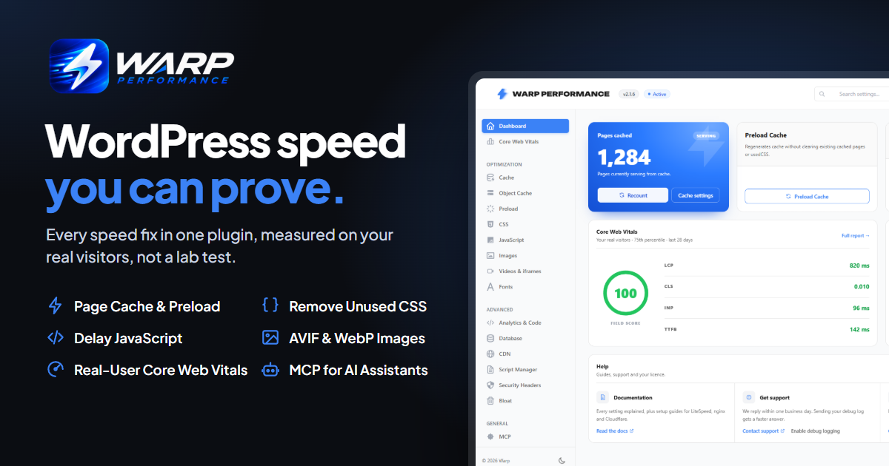
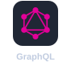
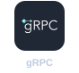
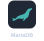
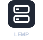
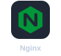

  

  

  
  
  

---

### 01 / Engineering for the traffic that comes next

I'm **Saurabh**, a full-stack engineer who designs the whole system: architecture, performance, caching, security, workflows, and product logic.

I've built platforms handling **20M+ daily views** with **Next.js, Node.js, Python, and WordPress**. My work connects the application to the infrastructure underneath it, so growth doesn't come at the cost of speed, stability, or security.

> **I engineer ecosystems that stay fast, stable, and secure at scale.**

  
  

### 02 / What I'm building

<table>
<tr>
<td width="50%" valign="top">

#### ⚡ Warp Performance

**WordPress performance, engineered across the stack.**

Cloud-powered optimization, page caching, unused CSS removal, and real-user Core Web Vitals monitoring. Native MCP integration brings performance diagnostics into AI workflows.

For teams who want a faster WordPress experience backed by real performance data.

**[Explore Warp Performance →](https://warpperformance.com/)**

</td>
<td width="50%" valign="top">

#### ☁️ CloudHashed

**Managed WordPress operations. Fewer fires. More shipping.**

Updates, verified backups, security, monitoring, and performance optimization, with infrastructure tuning to support the traffic your sites actually receive.

Warp Performance is included with every care plan.

**[Discover CloudHashed →](https://cloudhashed.com/)**

</td>
</tr>
</table>

### 03 / Stack & platforms

**Languages & runtimes**

  

**Frameworks & application development**

  

**Commerce, content & custom platforms**

  
  
  
  

**APIs, protocols & tooling**

  
  
  
  
  

**Databases & analytics**

  
  
  
  
  

**Caching & search**

  
  

**Operating systems & server stacks**

  
  
  
  

**Web servers**

  
  
  
  
  

**Infrastructure, hosting & containers**

  
  
  
  
  
  
  

**CDN & edge delivery**

  
  
  

**Architecture & operations**

  
  
  

### 04 / Where I go deep

| Discipline | Focus |
| :--- | :--- |
| **System architecture** | Designing how applications, services, data, and infrastructure work together |
| **Performance engineering** | Finding bottlenecks, tuning delivery, and improving real-user experience |
| **Caching & scale** | Cache strategy and traffic-aware application design |
| **Security & reliability** | Application hardening, recoverability, and stable operations |
| **Cloud & systems administration** | Infrastructure tuning, monitoring, and platform operations |
| **Product engineering** | Custom platforms, business workflows, and product logic |

---

<b>Have a platform that needs to handle what comes next?</b>

  <a href="https://cloudhashed.com/contact">Let's talk systems →</a>
  &nbsp; · &nbsp;
  <a href="https://warpperformance.com/">Make WordPress faster →</a>
  &nbsp; · &nbsp;
  <a href="https://github.com/SaurabhGtr?tab=repositories">Explore my work →</a>

ARCHITECTURE → PERFORMANCE → RELIABILITY → SCALE

